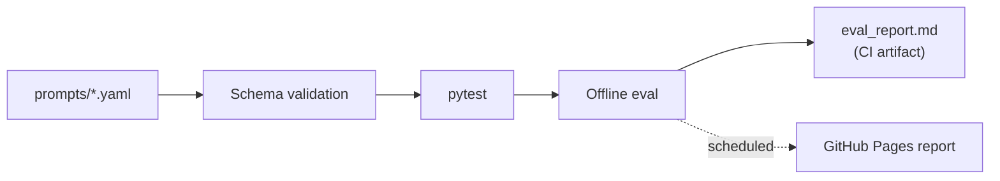

# 🤖 Prompt Engineering CI/CD


**Prompts as version-controlled software artifacts.** This repository demonstrates a small, offline-first prompt quality pipeline: YAML source, schema validation, Python tests, and a generated Markdown report on every GitHub Actions run.

> **Scope:** This repository tests prompt **structure and deterministic rendering heuristics**. It does not call an LLM or measure answer accuracy, hallucination rates, or real-world agent reliability. Those would require a model-backed evaluation suite and representative labeled cases.

## Why

Prompts that drive IT automation (ticket summaries, triage, Slack replies) break quietly when someone edits them. This repo shows a lightweight pipeline that catches broken or drifting prompts before they reach production.

## How it works



Each prompt is a YAML file with a name, an input schema, a Jinja2 template, and test cases:

```yaml
name: summarizer
input_schema:
  required: [body, tone]
template: |
  Use a {{ tone }} tone. Summarize this text in 3 bullet points: {{ body }}
tests:
  - id: test1
    input: { body: "User cannot login after reset.", tone: "friendly" }
```

## Explore the example

- [Example prompt: `prompts/summarizer.yaml`](prompts/summarizer.yaml) — a Jinja2 template with an input schema and an example test case.
- [Schema validator](scripts/validate_schema.py) — checks prompt files against the repository's top-level JSON Schema.
- [Offline evaluation script](scripts/eval_prompts.py) — renders each template with sample input and marks a minimum word-count heuristic as PASS/FAIL.
- [Unit tests](tests) — run via pytest in CI.

### Quick start: reproduce the checks

From the repository root, using Python 3.11:

```bash
python -m venv .venv
source .venv/bin/activate
pip install -r requirements.txt

python scripts/validate_schema.py
pytest -q
python scripts/eval_prompts.py
```

On Windows, activate with `.venv\\Scripts\\activate` rather than `source .venv/bin/activate`.

Open the generated `eval_report.md` to inspect the offline summary. It is intentionally not treated as evidence of LLM output quality.

### CI evidence and demos

The badge at the top links to the GitHub Actions workflow. Open [the Actions runs](https://github.com/Mrandrew9/Prompt-Engineering-/actions/workflows/prompt-ci.yml) to review executed checks and download the `eval-report` artifact from a run.

The Mermaid diagram is an architecture illustration, not a fabricated execution screenshot. For future visual evidence, capture a **real passing Actions run** and a **sanitized generated report**; remove any identifiers or sensitive prompt content before sharing.

## Workflows

| Workflow | Trigger | What it does |
|---|---|---|
| `prompt-ci.yml` | push, PR | Ruff + Black, schema validation, pytest, offline eval, uploads `eval_report.md` |
| `prompt-evals-pages.yml` | manual / scheduled | Runs evals and publishes the report to GitHub Pages |

## Add a prompt

1. Create `prompts/<name>.yaml` with `name`, `template`, and at least one entry under `tests`.
2. Open a pull request; CI validates and evaluates it automatically.

## Tech

Python 3.11 · Jinja2 · JSON Schema · pytest · Ruff · Black · GitHub Actions · GitHub Pages

## License

MIT
